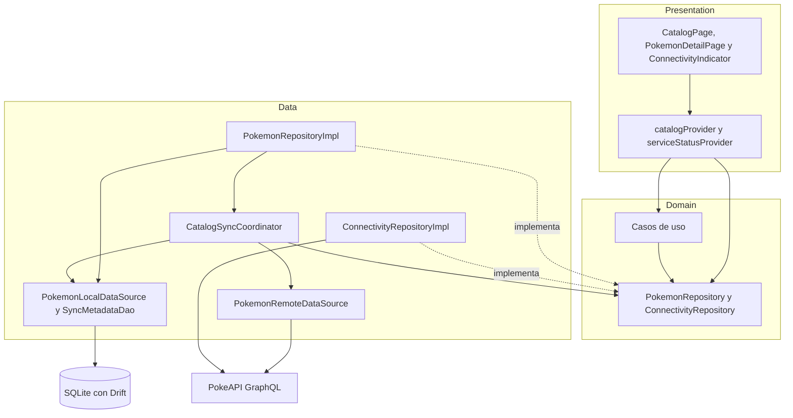
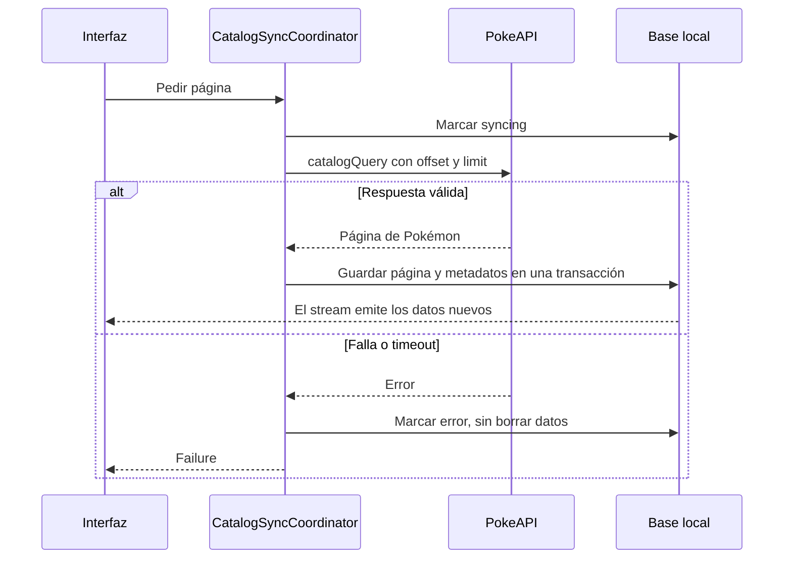

# Pokédex Flutter

Pokédex móvil construida con Flutter que consume la API GraphQL de PokeAPI y funciona con una arquitectura **Offline-First**: la interfaz siempre lee de una base de datos local, y la red solo sirve para mantener esa base actualizada.

Proyecto final de Desarrollo de Aplicaciones Móviles (PUCMM). Integrantes: Yuji Yamaki y Fanny Williams.

## Estado actual

Este README describe la entrega del **avance**. Lo que todavía no existe está en [Limitaciones conocidas](#limitaciones-conocidas).

| Funcionalidad | Estado |
|---|---|
| Catálogo paginado con nombre, número, imagen y tipos | Hecho |
| Estados de carga, vacío y error con «Reintentar» | Hecho |
| Consulta sin conexión, también después de reiniciar la app | Hecho |
| Indicador global de conectividad | Hecho |
| Detalle básico (imagen, número, nombre y tipos) | Hecho |
| Tabla y fuente de datos de favoritos | Hecho, sin pantalla todavía |
| Búsqueda, filtros, orden, detalle completo, favoritos y trivia | Entrega final |

## Requisitos de ejecución

- Flutter 3.47.7 (canal estable) con Dart 3.13.5 o superior.
- Un dispositivo o emulador Android. La aplicación se ha probado en Android; iOS no se ha probado.
- Internet la primera vez que se abre la aplicación, para descargar el catálogo.

## Instalación

```bash
git clone https://github.com/Rachi2/Pokedex-Flutter.git
cd Pokedex-Flutter
flutter pub get
flutter run
```

Los archivos `.g.dart` de Drift están en el repositorio. Solo hay que regenerarlos si se cambian las tablas:

```bash
dart run build_runner build
```

## Tecnologías

| Dependencia | Para qué se usa | Por qué |
|---|---|---|
| `flutter_riverpod` | Estado e inyección de dependencias | Modela flujos y estados asíncronos, y permite sustituir dependencias en pruebas. Ver [ADR-0002](docs/adr/0002-riverpod-estado-e-inyeccion.md) |
| `drift` | Base de datos local sobre SQLite | Esquema tipado, consultas observables, transacciones y migraciones. Ver [ADR-0001](docs/adr/0001-drift-como-fuente-de-verdad.md) |
| `graphql` | Cliente de la API de PokeAPI | Ejecuta las consultas GraphQL y permite desactivar su caché con `FetchPolicy.noCache` |
| `connectivity_plus` | Detectar cambios de red | Avisa cuándo cambia la red; la disponibilidad real se comprueba aparte contra la API |
| `cached_network_image` | Mostrar y guardar imágenes | Guarda las imágenes en disco para verlas sin conexión |
| `path_provider`, `path` | Ubicar el archivo de la base | Dan la carpeta de documentos de la aplicación y arman la ruta |
| `sqlite3_flutter_libs` | Soporte nativo de SQLite | Dependencia inicial del proyecto; su versión actual está marcada como descontinuada y queda pendiente revisar si se puede retirar |
| `cupertino_icons` | Íconos de iOS | Viene con la plantilla de Flutter |
| `drift_dev`, `build_runner` | Generar el código de Drift | Solo se usan durante el desarrollo |
| `flutter_lints` | Reglas de análisis estático | Conjunto de reglas recomendado para `flutter analyze` |

## Arquitectura

El código está organizado **por funcionalidades** (`pokemon`, `connectivity`, `favorites`) y cada una se divide en capas. Las dependencias apuntan hacia el dominio.

| Capa | Responsabilidad | Restricción |
|---|---|---|
| **Presentation** | Páginas, widgets y estado de pantalla | No toca GraphQL ni Drift |
| **Domain** | Entidades, contratos de repositorio y casos de uso | No depende de Flutter, GraphQL ni Drift |
| **Data** | Implementación de repositorios, fuentes de datos, DTO, mapeadores y sincronización | Traduce los errores técnicos a `Failure` |



**Recorrido de un Pokémon desde PokeAPI hasta la pantalla:**

1. `PokemonRemoteDataSource` ejecuta `catalogQuery` y convierte la respuesta en `PokemonDto`.
2. `CatalogSyncCoordinator` usa `PokemonMapper` para convertir los DTO en filas de Drift.
3. `PokemonLocalDataSource.upsertPage` guarda las filas dentro de una transacción.
4. El stream de Drift emite el cambio.
5. `PokemonRepositoryImpl` convierte las filas en entidades `Pokemon`.
6. `catalogProvider` calcula el estado de la pantalla.
7. `CatalogPage` lo muestra.

La respuesta de la red nunca llega directamente a un widget.

La inyección de dependencias se hace con providers de Riverpod: los compartidos están en `core/di/core_providers.dart` y los de la funcionalidad, en `features/pokemon/pokemon_providers.dart`.

## Estructura del proyecto

```text
lib/
├── main.dart
├── app/                     # Aplicación, tema y marco con la navegación (AppShell)
├── core/
│   ├── database/            # AppDatabase, tablas y SyncMetadataDao
│   ├── di/                  # Providers compartidos
│   ├── error/               # Tipos de Failure
│   └── network/             # Cliente GraphQL
└── features/
    ├── connectivity/
    │   ├── data/            # Red + comprobación real de la API
    │   ├── domain/          # ServiceStatus y contrato del repositorio
    │   └── presentation/    # ConnectivityIndicator
    ├── favorites/
    │   └── data/            # FavoritesLocalDataSource
    └── pokemon/
        ├── data/            # Fuentes de datos, DTO, consultas, mapper, repositorio y sync
        ├── domain/          # Entidades, contrato del repositorio y casos de uso
        ├── presentation/    # Páginas, providers y widgets
        └── pokemon_providers.dart
```

## Estrategia Offline-First

- **Fuente de verdad local.** Las pantallas observan streams de Drift. Cuando llegan datos remotos se guardan en la base, y la interfaz se entera porque la base cambió.
- **Sin caché de GraphQL.** El cliente usa `FetchPolicy.noCache`; así no hay dos copias de los datos. La razón está en el [ADR-0001](docs/adr/0001-drift-como-fuente-de-verdad.md).
- **Sin bloqueos.** La aplicación abre de inmediato y la sincronización corre en segundo plano, sin `await` en el arranque.
- **Degradación segura.** Si una descarga falla, se marca el error y los datos guardados se conservan.
- **Sin conexión.** Como la interfaz solo lee de la base, el catálogo y el detalle funcionan sin internet, también tras cerrar y reabrir la aplicación.
- **Imágenes.** `cached_network_image` las guarda en disco la primera vez que se muestran. Si una imagen no está guardada y no hay red, aparece el recurso «Imagen no disponible».

## GraphQL y paginación

- **Servicio:** `https://graphql.pokeapi.co/v1beta2`.
- **Consulta:** `catalogQuery` pide solo id, nombre, número, tipos, artwork y sprite, más el total de Pokémon. Filtra `is_default = true` para traer solo la forma principal de cada especie.
- **Paginación por offset**, con páginas de 50 (`catalogPageSize`). El servicio admite `limit` y `offset`, y al ordenar por `id` las páginas salen siempre en el mismo orden. El siguiente offset se guarda en `sync_metadata`, para continuar donde se quedó aunque se cierre la aplicación.
- **Timeout:** 10 segundos por consulta.
- **Errores:** se traducen a `NetworkFailure`, `TimeoutFailure`, `ServerFailure` o `UnknownFailure`, según corresponda. Los registros que llegan incompletos se descartan al convertir el JSON.

## Estrategia de sincronización

La sincronización es en una sola dirección, de PokeAPI a la base local. El catálogo **no se descarga completo** en la primera ejecución: se descarga por páginas.

| Evento | Qué hace |
|---|---|
| Abrir la app o recuperar la API, sin datos guardados o tras un error | Descarga la siguiente página |
| El usuario llega a unas 3 filas del final | Descarga la siguiente página |
| Deslizar hacia abajo o tocar el botón de actualizar | Vuelve a pedir la primera página |
| Tocar «Reintentar» | Pide la siguiente página |



- **Sin duplicados.** Los registros se identifican por el `id` de PokeAPI y se guardan con `insertOnConflictUpdate`.
- **Sin descargas simultáneas.** Si ya hay una en curso, `_running` devuelve esa misma en lugar de iniciar otra.
- **Escrituras completas.** Los Pokémon y los metadatos se guardan en la misma transacción: o se guarda todo o no se guarda nada.
- **El avance no retrocede.** Actualizar la primera página no reinicia el offset guardado.

## Persistencia local

La base es SQLite con Drift, en el archivo `pokedex.sqlite` (esquema versión 1).

| Tabla | Contenido | Clave primaria | Otras restricciones e índices |
|---|---|---|---|
| `pokemon` | id, número, nombre, sprite, artwork y fecha de actualización | `id` | Índices `pokemon_name_idx` y `pokemon_dex_number_idx` |
| `types` | id y nombre | `id` | |
| `pokemon_types` | Relación Pokémon-tipo con su slot | `(pokemon_id, slot)` | Único `(pokemon_id, type_id)`; `slot` solo admite 1 o 2; claves foráneas con borrado en cascada |
| `favorites` | id del Pokémon y fecha | `pokemon_id` | Sin clave foránea, a propósito |
| `sync_metadata` | Estado, última sincronización, siguiente offset y total remoto | `resource_key` | |

Las claves foráneas se activan con `PRAGMA foreign_keys = ON` al abrir la base.

**Datos del usuario.** `favorites` no tiene clave foránea hacia `pokemon` y la sincronización nunca escribe en esa tabla. Así, los favoritos no dependen de lo que pase con el catálogo.

## Gestión de conectividad

Se manejan por separado dos cosas: la **disponibilidad del servicio** (`ServiceStatus`) y la **sincronización** (`CatalogSyncStatus`). El indicador las combina.

`ConnectivityRepositoryImpl` comprueba en dos pasos:

1. Con `connectivity_plus` mira si hay red. Si no hay, el estado es `offline`.
2. Si hay red, ejecuta la consulta mínima `{ __typename }`, con un límite de 5 segundos. Si responde, el estado es `online`; si falla o tarda demasiado, `unavailable`.

Para evitar parpadeos, los cambios de red esperan 1,5 segundos antes de evaluarse y no se emiten estados repetidos. Además, se vuelve a comprobar cada 30 segundos.

| Estado del indicador | Cuándo aparece | Segunda línea |
|---|---|---|
| Comprobando conexión | Todavía no se sabe el estado | Última sincronización, si la hay |
| En línea | La API responde | Hora de la última actualización |
| Sincronizando… | La API responde y hay una descarga en curso | «En línea · puedes seguir navegando» |
| Sin conexión | No hay red | «Datos locales · última sync» y la hora |
| Servicio no disponible | Hay red, pero la API no responde | «Datos locales · última sync» y la hora |

El indicador combina ícono y texto, tiene una etiqueta `Semantics` y anuncia los cambios a los lectores de pantalla. Está arriba en la navegación principal y en forma compacta en el detalle.

## Funcionalidades adicionales

- Tema claro y oscuro según el sistema, con Material Design 3.
- Deslizar hacia abajo y botón para actualizar el catálogo.
- Nombres de los tipos en español, cada uno con su color.

## Limitaciones conocidas

**Errores conocidos:**

- Si la aplicación se cierra a mitad de una descarga, `sync_metadata` puede quedar en `syncing`: el indicador sigue diciendo «Sincronizando» y el scroll deja de pedir páginas. Deslizar hacia abajo con conexión lo corrige.
- En la primera ejecución, con internet pero con PokeAPI caída, se quedan las filas de carga sin botón «Reintentar».
- La fila del catálogo tiene un alto fijo y se desborda cuando el texto del sistema está al 130 % o más.

**Pendiente para la entrega final:**

- Búsqueda, filtros y orden.
- Detalle completo: estadísticas, habilidades, evoluciones, movimientos y debilidades.
- Pantalla de favoritos y trivia.
- Detección y restauración de datos alterados en la base local (OF-19 a OF-21).
- Reintentos automáticos con backoff y manejo específico de la limitación de peticiones.
- Actualizar los datos al recuperar la conexión cuando ya hay datos guardados: hoy solo se sincroniza si no hay datos o si la última vez falló.
- Límite de la caché de imágenes. Se usa la configuración por defecto, de 200 archivos, insuficiente para el catálogo completo.
- Comprobación de conectividad duplicada: el coordinador y el indicador abren cada uno la suya.
- Revisar `sqlite3_flutter_libs`.

## Decisiones de arquitectura

- [ADR-0001: Drift como fuente de verdad](docs/adr/0001-drift-como-fuente-de-verdad.md)
- [ADR-0002: Riverpod para estado e inyección de dependencias](docs/adr/0002-riverpod-estado-e-inyeccion.md)

## Uso de inteligencia artificial

Durante el desarrollo se usó Claude (Anthropic) como apoyo en el frontend, para explicar código y para generar este README y los ADR. Ambos integrantes revisamos lo generado y somos responsables de todo el código entregado.
