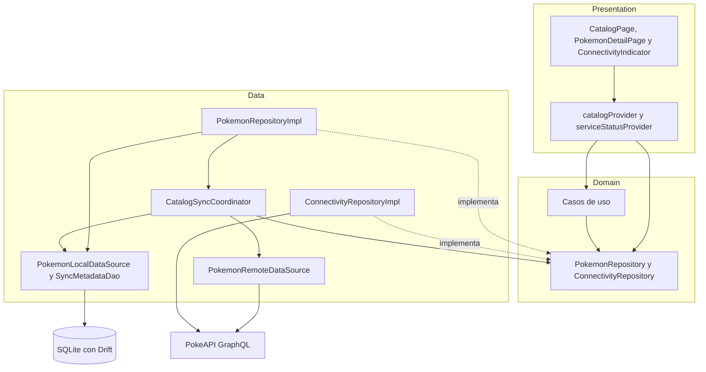
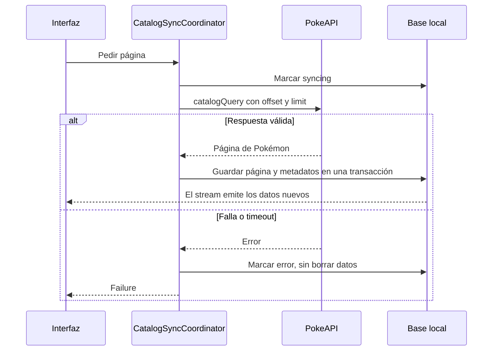

# Pokédex Flutter

Pokédex móvil construida con Flutter que consume la API GraphQL de PokeAPI y funciona con una arquitectura **Offline-First**: la interfaz siempre lee de una base de datos local, y la red solo sirve para mantener esa base actualizada.

Proyecto final de Desarrollo de Aplicaciones Móviles (PUCMM). Integrantes: Yuji Yamaki y Fanny Williams.

## Estado actual

Este README describe la entrega del **avance**. Lo que todavía no existe está en [Limitaciones conocidas](#limitaciones-conocidas).

| Funcionalidad | Estado |
|---|---|
| Catálogo paginado con nombre, número, imagen y tipos | Hecho |
| Descarga y actualización del catálogo en segundo plano (Online-Preferred) | Hecho |
| Estados de carga, vacío y error con «Reintentar» | Hecho |
| Consulta sin conexión, también después de reiniciar la app | Hecho |
| Indicador global de conectividad | Hecho |
| Detalle básico (carrusel de imágenes, número, nombre y tipos) | Hecho |
| Tabla y fuente de datos de favoritos | Hecho, sin pantalla todavía |
| Búsqueda, filtros, orden, detalle completo, favoritos y trivia | Entrega final |

## Requisitos de ejecución

- Flutter 3.47.7 (canal estable) con Dart 3.13.5 o superior.
- Un dispositivo o emulador Android. La aplicación se ha probado en Android; iOS no se ha probado.
- Internet la primera vez que se abre la aplicación, para descargar el catálogo.

## Instalación

```bash
git clone https://github.com/Rachi2/Pokedex-Flutter.git
cd Pokedex-Flutter
flutter pub get
flutter run
```

Los archivos `.g.dart` de Drift están en el repositorio. Solo hay que regenerarlos si se cambian las tablas:

```bash
dart run build_runner build
```

## Tecnologías

| Dependencia | Para qué se usa | Por qué |
|---|---|---|
| `flutter_riverpod` | Estado e inyección de dependencias | Modela flujos y estados asíncronos, y permite sustituir dependencias en pruebas. Ver [ADR-0002](docs/adr/0002-riverpod-estado-e-inyeccion.md) |
| `drift` | Base de datos local sobre SQLite | Esquema tipado, consultas observables, transacciones y migraciones. Ver [ADR-0001](docs/adr/0001-drift-como-fuente-de-verdad.md) |
| `graphql` | Cliente de la API de PokeAPI | Ejecuta las consultas GraphQL y permite desactivar su caché con `FetchPolicy.noCache` |
| `connectivity_plus` | Detectar cambios de red | Avisa cuándo cambia la red; la disponibilidad real se comprueba aparte contra la API |
| `cached_network_image` | Mostrar y guardar imágenes | Guarda las imágenes en disco para verlas sin conexión |
| `flutter_cache_manager` | Configurar la caché de imágenes | Fija el límite de archivos y el tiempo sin uso antes de borrarlos; ya venía dentro de `cached_network_image` y se declara porque se usa directamente |
| `path_provider`, `path` | Ubicar el archivo de la base | Dan la carpeta de documentos de la aplicación y arman la ruta |
| `sqlite3_flutter_libs` | Soporte nativo de SQLite | Dependencia inicial del proyecto; su versión actual está marcada como descontinuada y queda pendiente revisar si se puede retirar |
| `cupertino_icons` | Íconos de iOS | Viene con la plantilla de Flutter |
| `drift_dev`, `build_runner` | Generar el código de Drift | Solo se usan durante el desarrollo |
| `flutter_lints` | Reglas de análisis estático | Conjunto de reglas recomendado para `flutter analyze` |

## Arquitectura

El código está organizado **por funcionalidades** (`pokemon`, `connectivity`, `favorites`) y cada una se divide en capas. Las dependencias apuntan hacia el dominio.

| Capa | Responsabilidad | Restricción |
|---|---|---|
| **Presentation** | Páginas, widgets y estado de pantalla | No toca GraphQL ni Drift |
| **Domain** | Entidades, contratos de repositorio y casos de uso | No depende de Flutter, GraphQL ni Drift |
| **Data** | Implementación de repositorios, fuentes de datos, DTO, mapeadores y sincronización | Traduce los errores técnicos a `Failure` |



**Recorrido de un Pokémon desde PokeAPI hasta la pantalla:**

1. `PokemonRemoteDataSource` ejecuta `catalogQuery` y convierte la respuesta en `PokemonDto`.
2. `CatalogSyncCoordinator` usa `PokemonMapper` para convertir los DTO en filas de Drift.
3. `PokemonLocalDataSource.upsertPage` guarda las filas dentro de una transacción.
4. El stream de Drift emite el cambio.
5. `PokemonRepositoryImpl` convierte las filas en entidades `Pokemon`.
6. `catalogProvider` calcula el estado de la pantalla.
7. `CatalogPage` lo muestra.

La respuesta de la red nunca llega directamente a un widget.

La inyección de dependencias se hace con providers de Riverpod: los compartidos están en `core/di/core_providers.dart` y los de la funcionalidad, en `features/pokemon/pokemon_providers.dart`.

## Estructura del proyecto

```text
lib/
├── main.dart
├── app/                     # Aplicación, tema y marco con la navegación (AppShell)
├── core/
│   ├── database/            # AppDatabase, tablas y SyncMetadataDao
│   ├── di/                  # Providers compartidos
│   ├── error/               # Tipos de Failure
│   ├── images/              # Caché de imágenes (PokemonImageCache)
│   └── network/             # Cliente GraphQL
└── features/
    ├── connectivity/
    │   ├── data/            # Red + comprobación real de la API
    │   ├── domain/          # ServiceStatus y contrato del repositorio
    │   └── presentation/    # ConnectivityIndicator
    ├── favorites/
    │   └── data/            # FavoritesLocalDataSource
    └── pokemon/
        ├── data/            # Fuentes de datos, DTO, consultas, mapper, repositorio y sync
        ├── domain/          # Entidades, contrato del repositorio y casos de uso
        ├── presentation/    # Páginas, providers y widgets
        └── pokemon_providers.dart
```

## Estrategia Offline-First

- **Fuente de verdad local.** Las pantallas observan streams de Drift. Cuando llegan datos remotos se guardan en la base, y la interfaz se entera porque la base cambió.
- **Sin caché de GraphQL.** El cliente usa `FetchPolicy.noCache`; así no hay dos copias de los datos. La razón está en el [ADR-0001](docs/adr/0001-drift-como-fuente-de-verdad.md).
- **Online-Preferred.** Cuando la API está disponible, la aplicación actualiza el catálogo por su cuenta, al abrirse y cada vez que vuelve la conexión, y guarda lo nuevo en la base. Lo que se ve viene siempre de la base, pero esa base se mantiene al día con PokeAPI.
- **Sin bloqueos.** La aplicación abre de inmediato y la sincronización corre en segundo plano, sin `await` en el arranque.
- **Degradación segura.** Si una descarga falla, se marca el error y los datos guardados se conservan.
- **Sin conexión.** Como la interfaz solo lee de la base, el catálogo y el detalle funcionan sin internet, también tras cerrar y reabrir la aplicación.
- **Imágenes (PS-08).** El artwork oficial y el sprite de cada Pokémon se guardan en disco la primera vez que se muestran, en una caché propia (`PokemonImageCache`) que comparten todas las pantallas. Admite hasta 3000 archivos: alcanza para los 1025 artworks y los 1025 sprites del catálogo, más las formas. Un artwork pesa unos 135 KB y un sprite, 1 KB, así que el catálogo completo ocupa unos 140 MB. Una imagen que no se usa en 90 días se borra, y si se pasa del límite se borran primero las que llevan más tiempo sin usarse. Si una imagen no está guardada y no hay red, aparece el recurso «Imagen no disponible».

## GraphQL y paginación

- **Servicio:** `https://graphql.pokeapi.co/v1beta2`.
- **Consulta:** `catalogQuery` pide solo id, nombre, número, tipos, artwork y sprite, más el total de Pokémon. Filtra `is_default = true` para traer solo la forma principal de cada especie.
- **Paginación por offset**, con páginas de 50 (`catalogPageSize`). El servicio admite `limit` y `offset`, y al ordenar por `id` las páginas salen siempre en el mismo orden. El siguiente offset se guarda en `sync_metadata`, para continuar donde se quedó aunque se cierre la aplicación.
- **Timeout:** 10 segundos por consulta.
- **Errores:** se traducen a `NetworkFailure`, `TimeoutFailure`, `ServerFailure` o `UnknownFailure`, según corresponda. Los registros que llegan incompletos se descartan al convertir el JSON.

## Estrategia de sincronización

La sincronización es en una sola dirección, de PokeAPI a la base local, y se hace por páginas de 50.

**Carga inicial (PS-02).** El catálogo completo se descarga **en segundo plano**, página por página, mientras el usuario navega: no hace falta esperar a que termine para usar la app. Cada página pesa unos 18 KB y tarda entre 0,25 y 0,45 s; con una pausa de medio segundo entre páginas (`pageDelay`), los 1025 Pokémon se completan en unos 15 a 20 segundos. Las imágenes no se descargan con el catálogo: se guardan la primera vez que se muestran.

| Evento | Qué hace |
|---|---|
| Abrir la app con la API disponible, o recuperar la conexión | **Actualización en segundo plano:** vuelve a descargar las páginas ya guardadas, sobrescribiendo con lo de PokeAPI, y después descarga las que faltan |
| El usuario llega a unas 3 filas del final | Descarga la siguiente página, si la actualización en segundo plano no la está descargando ya |
| Deslizar la lista hacia abajo | Actualización manual: vuelve a pedir la primera página |
| Tocar «Reintentar» | Pide la siguiente página |

**Cuándo se detiene la actualización en segundo plano:** cuando no quedan páginas, cuando se pierde la conexión con la API, cuando falla una página (queda marcado el error) o cuando se cierra la app. Al volver la conexión empieza de nuevo. Si la app se cerró a mitad de una descarga, al abrirla se marca como fallida y se retoma.



- **Sin duplicados.** Los registros se identifican por el `id` de PokeAPI y se guardan con `insertOnConflictUpdate`.
- **Sin descargas simultáneas.** Si ya hay una en curso, `_running` devuelve esa misma en lugar de iniciar otra. La actualización en segundo plano espera a que termine la descarga que pidió el usuario antes de hacer la suya, y nunca corren dos actualizaciones a la vez (`_batch`).
- **Escrituras completas.** Los Pokémon y los metadatos se guardan en la misma transacción: o se guarda todo o no se guarda nada.
- **El avance no retrocede.** Volver a descargar las primeras páginas no reinicia el offset guardado.
- **Sin parpadeo.** Durante toda la actualización en segundo plano el estado queda en `syncing`, y pasa a `success` una sola vez al terminar, así el indicador no cambia en cada página (IND-06).
- **Datos alterados.** Como cada actualización sobrescribe las filas guardadas con lo de PokeAPI, un dato del catálogo modificado en la base vuelve a su valor original la próxima vez que se abre la app, vuelve la conexión o pasa la actualización periódica de cada 5 minutos. Favoritos no se toca.

## Persistencia local

La base es SQLite con Drift, en el archivo `pokedex.sqlite` (esquema versión 2, con 20 tablas). Las tablas del catálogo y del detalle usan los ids de PokeAPI. Las claves foráneas se activan con `PRAGMA foreign_keys = ON` al abrir la base, y todas las de esta lista borran en cascada.

**Catálogo**

| Tabla | Contenido | Clave primaria | Otras restricciones e índices |
|---|---|---|---|
| `pokemon` | id, número, nombre, sprite, artwork, altura, peso, generación, `is_default` y fecha de actualización | `id` | Índices `pokemon_name_idx`, `pokemon_dex_number_idx` y `pokemon_gen_idx`. `is_default` separa la forma normal de las megas y gigamax, que se guardan como filas aparte con el mismo número |
| `types` | id y nombre | `id` | |
| `pokemon_types` | Tipos de cada Pokémon con su slot | `(pokemon_id, slot)` | Único `(pokemon_id, type_id)`; `slot` solo admite 1 o 2 |
| `type_efficacies` | Multiplicador de daño de cada tipo atacante contra cada tipo defensor (18 × 18) | `(defending_type_id, attacking_type_id)` | `damage_factor` solo admite 0, 50, 100 o 200; dos claves foráneas a `types` |

**Detalle**

| Tabla | Contenido | Clave primaria | Otras restricciones e índices |
|---|---|---|---|
| `stats` | id y nombre de las seis estadísticas | `id` | |
| `pokemon_stats` | Valor base y puntos de esfuerzo de cada Pokémon por estadística | `(pokemon_id, stat_id)` | `base_stat` de 1 a 255; `effort` de 0 a 3 |
| `egg_groups` | id y nombre de los grupos huevo | `id` | |
| `pokemon_egg_groups` | Grupos huevo de cada Pokémon | `(pokemon_id, egg_group_id)` | |
| `abilities` | id, nombre, y nombre y efecto en español e inglés | `id` | |
| `pokemon_abilities` | Habilidades de cada Pokémon con su slot e `is_hidden` | `(pokemon_id, slot)` | Único `(pokemon_id, ability_id)`; `slot` de 1 a 3 |
| `evolution_species` | Especies de cada cadena evolutiva; `evolves_from_id` apunta a la anterior y forma las ramas | `species_id` | Índice `evolution_species_chain_idx`. Sin clave foránea a `pokemon`: la cadena incluye especies que pueden no estar guardadas |
| `evolution_methods` | Disparador de cada evolución: nivel, objeto, objeto equipado, amistad u hora | `id` | Clave foránea a `evolution_species` |
| `moves` | id, nombres, tipo, potencia, precisión, PP y clase de daño | `id` | `type_id` sin clave foránea: el tipo puede no estar guardado |
| `pokemon_moves` | Movimientos de cada Pokémon por método y nivel | `(pokemon_id, method, level, move_id)` | `level` de 0 a 100 (0 para MT, tutor, huevo y al evolucionar) |

**Datos del usuario y metadatos**

| Tabla | Contenido | Clave primaria | Otras restricciones e índices |
|---|---|---|---|
| `favorites` | id del Pokémon y fecha | `pokemon_id` | Sin clave foránea, a propósito |
| `trivia_results` | Una fila por partida: puntaje, aciertos, total de preguntas y fecha | `id` autoincremental | `score` ≥ 0; aciertos entre 0 y el total de preguntas; índice `trivia_results_score_idx` para el ranking |
| `trivia_answers` | Respuesta de cada pregunta de una partida | `(result_id, question_number)` | Clave foránea a `trivia_results`; `pokemon_id` sin clave foránea, a propósito |
| `achievements` | Logros desbloqueados y cuándo | `id` (texto) | Qué logros existen y sus umbrales se definen en el código |
| `preferences` | Ajustes del usuario en pares clave-valor (tema, idioma, filtros) | `key` | |
| `sync_metadata` | Estado, última sincronización, siguiente offset y total remoto | `resource_key` | |

**Índices y consultas (RNF-REN-03).** Además de los índices declarados, cada clave primaria compuesta funciona como índice, y su orden está elegido para la consulta que la usa: `pokemon_moves` filtra por Pokémon y método y devuelve las filas ya ordenadas por nivel; `type_efficacies` busca por tipo defensor para calcular las debilidades.

**Migración de la versión 1 a la 2.** `onUpgrade` crea las tablas, columnas e índices nuevos sin tocar los datos guardados. `is_default` entra con valor `true` para que los Pokémon que ya estaban en la base sigan saliendo en el catálogo. Los favoritos se conservan.

**Datos del usuario.** `favorites`, `trivia_answers` y `achievements` no tienen clave foránea hacia el catálogo, y la sincronización nunca escribe en esas tablas ni en `trivia_results` o `preferences`. Así, los datos del usuario no dependen de lo que pase con el catálogo (PS-11).

## Inspección de la base de datos

Para ver y modificar la base mientras la app corre se usa la extensión de Drift para Flutter DevTools. Viene dentro del paquete `drift`, así que no hace falta ninguna dependencia nueva, y queda activada para todo el equipo en `devtools_options.yaml`. Solo funciona en modo depuración.

**Cómo abrirla:**

1. Ejecutar la app en modo depuración (`flutter run` o Run/Debug en Android Studio).
2. Abrir DevTools **en el navegador**, con el enlace que aparece en la consola: `The Flutter DevTools debugger and profiler ... is available at: http://127.0.0.1:...`. El panel de DevTools integrado en Android Studio no muestra la extensión.
3. Entrar en la pestaña **drift** y elegir `AppDatabase`. El botón **Validate again** comprueba que el esquema de la base coincide con las tablas del código.
4. Elegir una tabla para ver sus filas. En **Edit Query** se puede escribir SQL.

**Contar registros por entidad (PA-13):**

```sql
SELECT count(*) FROM pokemon
```

**Alterar un dato del catálogo y ver la restauración (PA-16):**

1. En **Edit Query**: `UPDATE pokemon SET name = 'prueba' WHERE id = 1`. La tabla de la extensión muestra el cambio, pero la pantalla de la app no: el SQL de la extensión no pasa por las notificaciones de Drift, así que los streams no se enteran.
2. Para mostrar el dato alterado en la app: desactivar la conexión y reabrir la app. El catálogo muestra «Prueba», leído de la base.
3. Volver a activar la conexión sin cerrar la app. La actualización en segundo plano sobrescribe la fila con lo de PokeAPI y la pantalla vuelve a mostrar «Bulbasaur» sola, porque esa escritura sí pasa por Drift. Los favoritos no cambian.

Sin los pasos 2 y 3 también se restaura: con la API disponible, el catálogo se vuelve a descargar cada 5 minutos, así que basta con alterar el dato y esperar.

## Simulador de API caída (PA-08)

Para mostrar qué pasa cuando hay red pero PokeAPI no responde, la app trae un simulador que solo funciona en modo depuración. Mientras está encendido, cada consulta a PokeAPI se corta antes de salir con un error 503, también la comprobación de conectividad.

**Cómo usarlo:**

1. Ejecutar la app en modo depuración y abrir la pestaña **Ajustes**.
2. Encender **Simular API caída**. El indicador pasa a **Servicio no disponible** en ese momento.
3. En el catálogo, deslizar la lista hacia abajo para pedir una actualización. Los datos guardados se siguen mostrando.
4. Apagar el interruptor. El indicador vuelve a **En línea** y la actualización en segundo plano se retoma en unos segundos.

**Qué se ve en la consola:** cada consulta bloqueada y la política de reintentos, con 4 intentos y esperas de 1, 2 y 4 segundos:

```text
[Simulador] Consulta bloqueada: API caida simulada
[GraphQL] Catalog <- ServerFailure
[Retry] Catalog offset 0: intento 1 de 4 fallo (ServerFailure). Reintento en 1000 ms
[Retry] Catalog offset 0: intento 2 de 4 fallo (ServerFailure). Reintento en 2000 ms
[Retry] Catalog offset 0: intento 3 de 4 fallo (ServerFailure). Reintento en 4000 ms
```

En una versión de producción el interruptor no aparece y el simulador no hace nada.

## Gestión de conectividad

Se manejan por separado dos cosas: la **disponibilidad del servicio** (`ServiceStatus`) y la **sincronización** (`CatalogSyncStatus`). El indicador las combina.

`ConnectivityRepositoryImpl` comprueba en dos pasos:

1. Con `connectivity_plus` mira si hay red. Si no hay, el estado es `offline`.
2. Si hay red, ejecuta la consulta mínima `{ __typename }`, con un límite de 5 segundos. Si responde, el estado es `online`; si falla o tarda demasiado, `unavailable`.

Para evitar parpadeos, los cambios de red esperan 1,5 segundos antes de evaluarse y no se emiten estados repetidos. Además, se vuelve a comprobar cada 30 segundos.

| Estado del indicador | Cuándo aparece | Segunda línea |
|---|---|---|
| Comprobando conexión | Todavía no se sabe el estado | Última sincronización, si la hay |
| En línea | La API responde | Hora de la última actualización |
| Sincronizando… | La API responde y hay una descarga en curso | «En línea · puedes seguir navegando» |
| Sin conexión | No hay red | «Datos locales · última sync» y la hora |
| Servicio no disponible | Hay red, pero la API no responde | «Datos locales · última sync» y la hora |

El indicador combina ícono y texto, tiene una etiqueta `Semantics` y anuncia los cambios a los lectores de pantalla. Está arriba en la navegación principal y, en forma compacta, en la barra superior del detalle y de la navegación principal en horizontal.

## Funcionalidades adicionales

- Tema claro y oscuro según el sistema, con Material Design 3.
- Deslizar la lista hacia abajo para actualizar el catálogo.
- Botón para volver al inicio de la lista.
- Carrusel en el detalle para pasar del artwork oficial al arte en píxeles.
- Nombres de los tipos en español, cada uno con su color.

## Limitaciones conocidas

**Errores conocidos:**

- La fila del catálogo tiene un alto fijo y se desborda cuando el texto del sistema está al 130 % o más.

**Pendiente para la entrega final:**

- Búsqueda, filtros y orden.
- Detalle completo: estadísticas, habilidades, evoluciones, movimientos y debilidades.
- Pantalla de favoritos y trivia.
- Restauración de datos alterados (OF-20): ya se sobrescriben al abrir la app, al volver la conexión y cada 5 minutos con la API disponible; falta la comprobación al abrir el detalle, que llega con el detalle completo.
- Comprobación de conectividad duplicada: el coordinador y el indicador abren cada uno la suya.
- Revisar `sqlite3_flutter_libs`.

## Decisiones de arquitectura

- [ADR-0001: Drift como fuente de verdad](docs/adr/0001-drift-como-fuente-de-verdad.md)
- [ADR-0002: Riverpod para estado e inyección de dependencias](docs/adr/0002-riverpod-estado-e-inyeccion.md)

## Uso de inteligencia artificial

Durante el desarrollo se usó Claude (Anthropic) como apoyo en el frontend, para explicar código y para generar este README y los ADR. Ambos integrantes revisamos lo generado y somos responsables de todo el código entregado.
