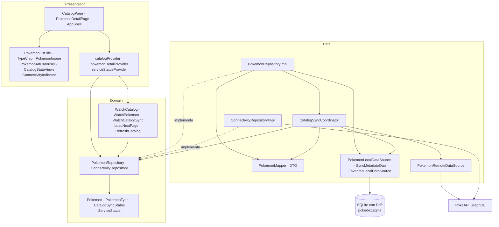
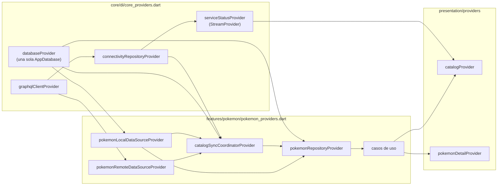
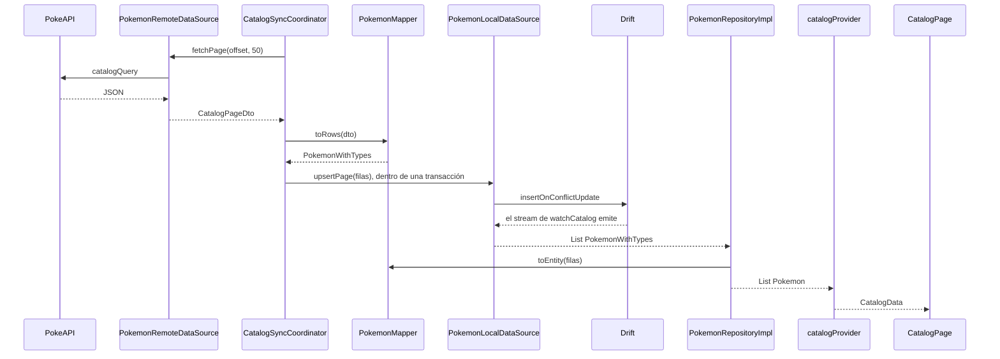
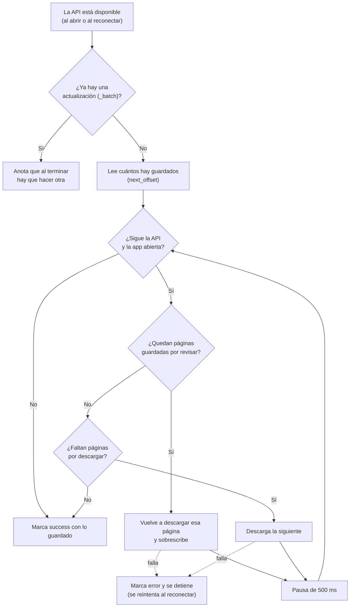
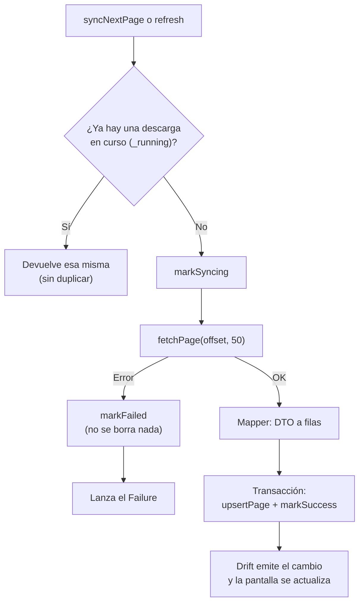
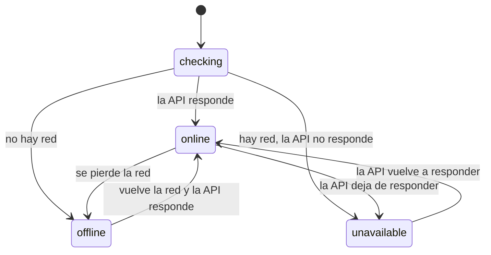
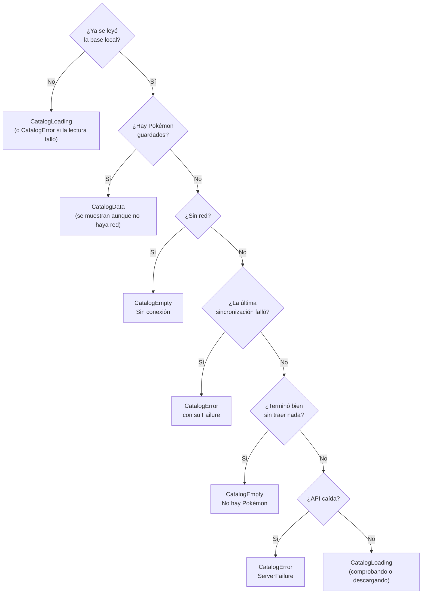
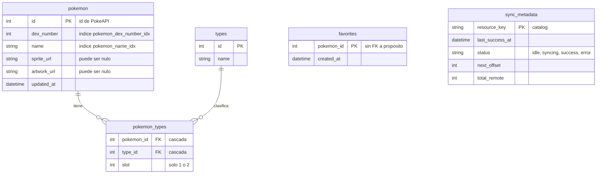

# Arquitectura de la Pokédex

Este documento describe cómo está construida la aplicación, según la rama `main` (commit `37b7279`).

**La idea central es Offline-First:** la interfaz **nunca** usa una respuesta de la red. Siempre lee de la base de datos local (Drift), y la red solo sirve para mantener esa base actualizada. Por eso, todo lo que se muestra con conexión también se ve sin ella.

## Índice

1. [Capas y regla de dependencias](#1-capas-y-regla-de-dependencias)
2. [Organización por funcionalidades](#2-organización-por-funcionalidades)
3. [Componentes de cada capa](#3-componentes-de-cada-capa)
4. [Inyección de dependencias](#4-inyección-de-dependencias)
5. [Recorrido de un Pokémon hasta la pantalla](#5-recorrido-de-un-pokémon-hasta-la-pantalla)
6. [Sincronización](#6-sincronización)
7. [Conectividad e indicador](#7-conectividad-e-indicador)
8. [Estado de la pantalla del catálogo](#8-estado-de-la-pantalla-del-catálogo)
9. [Modelo de datos local](#9-modelo-de-datos-local)
10. [Modelo de errores](#10-modelo-de-errores)
11. [Decisiones y límites actuales](#11-decisiones-y-límites-actuales)

---

## 1. Capas y regla de dependencias

El código sigue Clean Architecture con tres capas. **Las dependencias apuntan hacia el dominio**: el dominio no conoce a nadie, y las otras dos capas dependen de él.

| Capa | Responsabilidad | Restricción |
|---|---|---|
| **Presentation** | Páginas, widgets y estado de pantalla (providers de Riverpod) | No usa GraphQL ni Drift |
| **Domain** | Entidades, contratos de repositorio y casos de uso | No depende de Flutter, GraphQL ni Drift |
| **Data** | Implementa los contratos: fuentes de datos, DTO, mapeadores, sincronización y repositorios | Es la única capa que habla con PokeAPI y con la base local; traduce los errores técnicos a `Failure` |



Las flechas punteadas significan "implementa el contrato". Fíjate que ninguna flecha sale de Domain hacia afuera.

## 2. Organización por funcionalidades

El código se agrupa **por funcionalidad** y, dentro de cada una, por capa. Lo que comparten varias funcionalidades va en `core/`.

```text
lib/
├── main.dart                  # Punto de entrada: ProviderScope + PokedexApp
├── app/                       # MaterialApp, tema, AppShell (cabecera, indicador, pestañas)
├── core/
│   ├── database/              # AppDatabase, tablas y SyncMetadataDao
│   ├── di/                    # Providers compartidos
│   ├── error/                 # Failure
│   └── network/               # Cliente GraphQL
└── features/
    ├── connectivity/          # ¿Se puede llegar a PokeAPI? + indicador
    │   ├── data/
    │   ├── domain/
    │   └── presentation/
    ├── favorites/             # Por ahora solo la fuente de datos local
    │   └── data/
    └── pokemon/               # Catálogo y detalle
        ├── data/
        ├── domain/
        ├── presentation/
        └── pokemon_providers.dart
```

La descripción de cada archivo está en el README, sección "Estructura del proyecto".

## 3. Componentes de cada capa

### Presentation

| Componente | Qué hace |
|---|---|
| `AppShell` | Marco de las pantallas principales: cabecera, indicador, pestañas en un `IndexedStack` y barra inferior. En horizontal, el indicador pasa a la cabecera en forma compacta |
| `CatalogPage` | Muestra la vista de cada estado del catálogo. La lista solo construye las filas visibles (`itemExtent` fijo), pide la siguiente página cerca del final, se actualiza al deslizar hacia abajo y tiene un botón para volver arriba |
| `PokemonDetailPage` | Detalle básico: carrusel artwork/píxel, número, nombre, tipos y la tarjeta "Datos guardados" |
| `catalogProvider` | Combina base local, sincronización y conectividad en un `CatalogState`. Expone `loadMore()`, `retry()` y `refresh()` |
| `ConnectivityIndicator` | Compone el estado de la red con el de la sincronización y lo muestra con ícono, texto y hora |

### Domain

| Componente | Qué hace |
|---|---|
| `Pokemon`, `PokemonType` | Entidades puras: id, nombre, número, URLs de artwork y sprite, tipos con su slot |
| `CatalogSyncStatus`, `SyncState` | Estado de la sincronización: `idle`, `syncing`, `success` o `error`, más la hora y si quedan páginas |
| `ServiceStatus` | Estado del servicio: `checking`, `online`, `offline` o `unavailable` |
| `PokemonRepository`, `ConnectivityRepository` | Contratos: qué se puede pedir, sin decir cómo |
| Casos de uso | Una clase por acción, con un método `call()` que delega en el repositorio |

### Data

| Componente | Qué hace |
|---|---|
| `PokemonRemoteDataSource` | Único lugar que usa GraphQL. Descarga una página con timeout de 10 s y traduce los errores |
| `PokemonLocalDataSource` | Único lugar que lee y escribe el catálogo en Drift. Emite streams y guarda páginas en transacción |
| `PokemonMapper` | Convierte DTO → filas de Drift → entidad `Pokemon` |
| `CatalogSyncCoordinator` | Decide cuándo descargar, evita descargas simultáneas y guarda cada página junto con sus metadatos |
| `PokemonRepositoryImpl` | Implementa el contrato: lee de la base y le pide las descargas al coordinador |
| `ConnectivityRepositoryImpl` | Combina `connectivity_plus` con una consulta mínima a la API |

## 4. Inyección de dependencias

Las dependencias se crean y se conectan con **providers de Riverpod**. Ninguna clase crea sus propias dependencias: las recibe por el constructor. Así se pueden reemplazar en las pruebas con `overrides`.



- `databaseProvider` crea **una sola** base y la cierra con `ref.onDispose`. Si hubiera dos conexiones al mismo archivo, una no se enteraría de los cambios de la otra.
- `connectivityRepositoryProvider` devuelve el **contrato** (`ConnectivityRepository`), no la implementación. Quien lo usa no sabe cómo se comprueba la conexión.
- `catalogSyncCoordinatorProvider` cierra su suscripción a la conectividad con `ref.onDispose`.

## 5. Recorrido de un Pokémon hasta la pantalla

Es la pregunta típica de la defensa: **"¿por dónde pasa un Pokémon desde PokeAPI hasta la pantalla?"**



Lo importante: **la respuesta de la red termina en la base de datos**. La pantalla se entera porque la base cambió (el stream emite), no porque llegó una respuesta. Por eso funciona igual con y sin conexión.

## 6. Sincronización

La sincronización va en una sola dirección: de PokeAPI a la base local. El catálogo se descarga **por páginas de 50**, con paginación por offset; el siguiente offset se guarda en `sync_metadata`, así que se retoma donde quedó aunque se cierre la app.

### Cuándo se descarga

| Evento | Qué hace |
|---|---|
| Al abrir la app | Si `sync_metadata` quedó en `syncing` (la app se cerró a mitad de una descarga), lo marca como `error`. Luego empieza a escuchar la conectividad |
| La API está disponible al abrir, o vuelve a responder | **Actualización en segundo plano** (Online-Preferred): vuelve a descargar las páginas ya guardadas y después las que faltan |
| El usuario llega a unas 3 filas del final | Descarga la siguiente página |
| Deslizar la lista hacia abajo | Actualización manual: vuelve a pedir la primera página, sin hacer retroceder el offset |
| Botón Reintentar | Pide la siguiente página |

### Actualización en segundo plano (Online-Preferred)

Cumple el principio P-02: con la API disponible, la app prioriza traer datos actualizados, sin bloquear la navegación. La pantalla sigue leyendo solo de la base.



- Durante toda la tanda el estado queda en `syncing` (`markSuccess(keepSyncing: true)`) y pasa a `success` una sola vez al final: el indicador no parpadea entre páginas (IND-06).
- Si el usuario ya está bajando una página con el scroll, la tanda espera a que termine y luego hace la suya (`_exclusive`).
- Como sobrescribe lo guardado con lo de PokeAPI, un dato del catálogo alterado en la base se restaura al abrir la app o al volver la conexión (parte de OF-19).
- El catálogo completo son 21 páginas de unos 18 KB; con la pausa, la tanda dura unos 15 a 20 segundos.

### Qué pasa en cada descarga



| Garantía | Cómo se logra |
|---|---|
| Sin duplicados | Los registros se identifican por el `id` de PokeAPI y se guardan con `insertOnConflictUpdate` |
| Sin descargas simultáneas | `_running` guarda la descarga en curso y las demás llamadas reciben esa misma |
| Sin datos a medias | La página y sus metadatos se guardan en la misma transacción |
| Sin perder datos al fallar | Un error solo marca `error` en `sync_metadata`; las filas guardadas no se tocan |
| El avance no retrocede | El siguiente offset es el mayor entre el guardado y el nuevo |

## 7. Conectividad e indicador

Se manejan por separado **dos dimensiones**, como pide el enunciado: la disponibilidad del servicio (`ServiceStatus`) y la sincronización (`SyncState`). El indicador las combina.

### Disponibilidad del servicio

`ConnectivityRepositoryImpl` comprueba en dos pasos:

1. Con `connectivity_plus` mira si hay red. Si no hay, el estado es `offline`.
2. Si hay red, envía la consulta mínima `{ __typename }` con un límite de 5 segundos. Si responde, el estado es `online`; si falla o tarda, `unavailable`.



Para no parpadear (IND-06), un cambio de red espera 1,5 segundos antes de evaluarse y no se emiten estados repetidos. Además, se vuelve a comprobar cada 30 segundos.

### Lo que muestra el indicador

| Estado | Cuándo | Segunda línea |
|---|---|---|
| Comprobando conexión | Todavía no se sabe | La última sincronización, si la hay |
| En línea | `online` | "Datos actualizados" con la hora |
| Sincronizando… | `online` y la sincronización en `syncing` | "En línea · puedes seguir navegando", con barra de progreso |
| Sin conexión | `offline` | "Datos locales · última sync" con la hora |
| Servicio no disponible | `unavailable` | "Datos locales · última sync" con la hora |

El indicador combina ícono y texto, tiene una etiqueta `Semantics` que anuncia los cambios (IND-05) y cambia con un fundido. En el detalle y en horizontal aparece en forma compacta, en la barra superior.

## 8. Estado de la pantalla del catálogo

`buildCatalogState` es una **función pura**: recibe los datos guardados, la sincronización, la conexión y el estado de las acciones, y devuelve uno de los cuatro estados sellados de `CatalogState`. Revisa los casos **en este orden**:



Como `CatalogState` es una clase sellada, `CatalogPage` usa un `switch` sin caso por defecto: si mañana se agrega un estado, el código no compila hasta decidir cómo mostrarlo.

## 9. Modelo de datos local

SQLite con Drift, archivo `pokedex.sqlite`, esquema versión 1. Las claves foráneas se activan con `PRAGMA foreign_keys = ON` al abrir la base.



- **`pokemon_types`** tiene clave primaria `(pokemon_id, slot)` y unicidad `(pokemon_id, type_id)`: un Pokémon no puede tener dos tipos en el mismo slot, ni el mismo tipo dos veces.
- **`favorites`** no tiene clave foránea hacia `pokemon` y la sincronización nunca la toca (PS-11): los datos del usuario no dependen de lo que pase con el catálogo.
- **`sync_metadata`** guarda el estado de cada recurso; hoy solo existe `catalog`.
- **Las imágenes no están en la base:** las guarda en disco `cached_network_image` la primera vez que se muestran.

## 10. Modelo de errores

Los errores técnicos nunca llegan a la pantalla tal cual: la capa de datos los traduce a uno de los cuatro tipos de la clase sellada `Failure`.

| Situación técnica | `Failure` | Mensaje para el usuario |
|---|---|---|
| Sin red o sin DNS (`NetworkException`, `SocketException`) | `NetworkFailure` | "Sin conexión a Internet" |
| La consulta superó los 10 s | `TimeoutFailure` | "El servidor tardó demasiado en responder" |
| Error GraphQL, respuesta vacía o con formato inválido | `ServerFailure` | "El servicio de Pokémon respondió con un error" |
| Cualquier otra cosa | `UnknownFailure` | "Ocurrió un error inesperado" |

`ErrorView` elige el ícono y el título según el tipo de `Failure`, con un `switch` que el compilador obliga a completar.

## 11. Decisiones y límites actuales

**Decisiones registradas:**
- [ADR-0001: Drift como fuente de verdad](adr/0001-drift-como-fuente-de-verdad.md)
- [ADR-0002: Riverpod para estado e inyección de dependencias](adr/0002-riverpod-estado-e-inyeccion.md)

**Límites de esta versión** (se resuelven en la entrega final):
- No hay reintentos automáticos con backoff ni manejo específico de la limitación de peticiones.
- Los datos del catálogo alterados en la base se restauran al abrir la app y al volver la conexión, pero todavía falta comprobarlos al abrir el detalle y periódicamente (OF-20).
- El detalle completo, los favoritos, la búsqueda, los filtros y la trivia todavía no existen.
